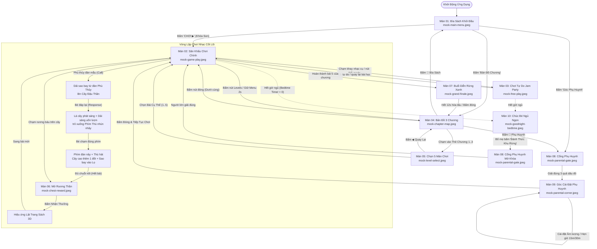

# HƯỚNG DẪN ĐỊNH HƯỚNG MÀN HÌNH & LUỒNG TƯƠNG TÁC (SCREEN FLOW GUIDE)
> **Dự án**: Rừng Nhạc (Enchanted Music Forest) — Sách Tranh Nổi Tương Tác Âm Nhạc 3D cho Trẻ 3–6 Tuổi  
> **Mục đích tài liệu**: Định vị chính xác thứ tự 10 màn hình, khớp nối trực tiếp với 10 file ảnh Mock chuẩn trong thư mục `docs/`, và chuẩn hóa toàn bộ luồng chuyển màn (state transitions & signals) để loại bỏ hoàn toàn sự lệch pha trong thiết kế và lập trình.

---

## I. Kim Chỉ Nam Thiết Kế Cho Trẻ Mầm Non (Design North Star)

1. **Trải nghiệm Không Chữ (Zero-Text Reliance)**:
   - Trẻ 3–5 tuổi **chưa biết đọc chữ**. Mọi lời thoại tiếng Việt/tiếng Anh hay ký hiệu nhạc lý hàn lâm (như "C4", "Combo", "Score") đều là rào cản.
   - Hướng dẫn phải bằng **Ánh Sáng (Glowing Aura)**, **Hoạt Cảnh Nhún Nhảy (Bouncing Animals)**, và **Dải Cầu Vồng Âm Nhạc (Magic Ribbon Trail)** nối trực tiếp từ nguồn đến đích.
2. **Không Bao Giờ Bế Tắc (Zero Dead Ends)**:
   - Bất kỳ màn hình nào cũng phải có nút thoát to bản, trực quan (chuẩn Apple Kids Category $\ge 88\text{ pt}$).
   - Chạm nhầm phím đàn không bị phạt, không mất sao, không có màn hình thua (Game Over).
3. **Mục Tiêu Thị Giác Rõ Ràng (Visual Goal)**:
   - Bé nhìn vào là hiểu ngay: *Bấm đàn để Cây Đậu Thần vươn cao lên trời đưa Rương Báu bung nắp!*

---

## II. Bảng Định Hướng 10 Màn Hình & File Mock Chuẩn

| STT | Tên Màn Hình & Mã Script | File Mock Chuẩn | Vai Trò & Thời Điểm Xuất Hiện | Yếu Tố Thị Giác Bắt Buộc (Theo Mock) |
| :---: | :--- | :--- | :--- | :--- |
| **01** | **Menu Khởi Đầu / Bìa Sách** `game/ui/main_menu.gd` | [`mock-main-menu.jpeg`](file:///Users/anhtu/MySpace/new-piano/docs/mock-main-menu.jpeg) | **Khởi động app lần đầu (FTUE)**: Sách đóng kín giữa rừng, mời bé bước vào thế giới thần tiên. | • Cuốn sách bìa da dập chữ 'RỪNG NHẠC' mạ vàng. • Nút **`CHƠI ▶`** khóa son khổng lồ phát sáng. • Nút **`Levels`** (ngôi sao) và **`Phụ Huynh`** (mặt trăng). |
| **02** | **Sân Khấu Chơi Chính (Core Loop)** `game/main.tscn` `game/call_response.gd` | [`mock-game-play.jpeg`](file:///Users/anhtu/MySpace/new-piano/docs/mock-game-play.jpeg) | **Trọng tâm 85% thời lượng**: Vòng gọi-đáp nuôi Cây Đậu Thần vươn tới Rương Báu. | • Sách mở 2 trang: Phù thủy nhỏ ngồi đàn piano bên trái. • **Cây Đậu Thần vươn cao** mang **Rương Báu trên ngọn** bên phải. • Dải nốt nhạc bay từ cây nối xuống 7 phím thú 3D. • Lọ thủy tinh thu thập sao góc phải trên. |
| **03** | **Sân Khấu Chơi Tự Do (Jam Party)** `game/main.tscn` *(Mode FREE)* `game/ui/instrument_switcher.gd` | [`mock-free-play.jpeg`](file:///Users/anhtu/MySpace/new-piano/docs/mock-free-play.jpeg) | **Chơi tự do / Sáng tạo**: Khi bé muốn gõ đàn thỏa thích không theo bài mẫu. | • Phù thủy nhỏ đeo kính ngôi sao tinh nghịch. • Bong bóng nốt nhạc ngũ sắc bay bổng. • Khay đổi 5 nhạc cụ gỗ nổi bật: Piano, Kalimba, Sáo, Chuông, Trống. |
| **04** | **Bản Đồ 3 Chương Sách Nổi** `game/ui/chapter_map.gd` | [`mock-chapter-map.jpeg`](file:///Users/anhtu/MySpace/new-piano/docs/mock-chapter-map.jpeg) | **Mục lục chọn thế giới**: Mở khi bé bấm nút `Levels` hoặc giữ nút Menu. | • Khung viền sách mở ra 3 thẻ chương 3D:   - Chương 1: Sáo Trúc Rừng Xanh (đang mở)   - Chương 2: Hồ Nước Kalimba (ổ khóa rơm/gỗ)   - Chương 3: Lâu Đài Chuông Gió (ổ khóa đồng) • Header Bar: `📖 Bìa Sách` & `🌙 Phụ Huynh`. |
| **05** | **Chọn 5 Màn Chơi (Level Select)** `game/ui/level_select.gd` | [`mock-level-select.jpeg`](file:///Users/anhtu/MySpace/new-piano/docs/mock-level-select.jpeg) | **Con đường bài hát của chương**: Mở khi bé chạm vào một thẻ Chương trên bản đồ. | • Con đường lát đá rêu xanh xuyên rừng. • 5 bục gỗ khoanh cây tương ứng 5 bài (1..5). • Bạn Thỏ trắng nhún nhảy vẫy tay ở bục đang chơi. • Bục số 5 có Rương Báu lấp lánh phần thưởng. |
| **06** | **Mở Rương Báu Thần** `game/ui/chest_reward.gd` | [`mock-chest-reward.jpeg`](file:///Users/anhtu/MySpace/new-piano/docs/mock-chest-reward.jpeg) | **Đỉnh cao phần thưởng (Dopamine)**: Khi bé vượt qua một bài hoặc chạm vào rương báu. | • Rương gỗ bung nắp, suối ánh sáng và sao vàng tuôn trào. • Huy hiệu bạn thú 3D vương giả (vd: Sư Tử Nhạc Sĩ). • Nút to tròn `NHẬN THƯỞNG 🌿`. |
| **07** | **Đại Hoan Ca Buổi Diễn Rừng Xanh** `game/ui/chapter_end.gd` | [`mock-grand-finale.jpeg`](file:///Users/anhtu/MySpace/new-piano/docs/mock-grand-finale.jpeg) | **Hoàn thành toàn bộ chương (5 bài)**: Phần thưởng cao nhất sau một hành trình. | • Sân khấu múa rối gỗ với rèm nhung đỏ sang trọng. • Cả 7 bạn thú và Phù Thủy cùng đứng biểu diễn hòa tấu 12s. • Cây đại thụ nở rực rỡ hoa trái trên đỉnh. |
| **08** | **Cổng Phụ Huynh Bảo Vệ** `game/ui/parental_gate.gd` | [`mock-parental-gate.jpeg`](file:///Users/anhtu/MySpace/new-piano/docs/mock-parental-gate.jpeg) | **Bảo vệ trẻ em (Apple Kids 1.3)**: Chắn trước mọi khu vực cài đặt hoặc thoát giờ ngủ. | • Bảng gỗ treo bằng xích sắt cổ kính. • Câu đố trực quan xúc giác: *"Chạm vào 3 quả dâu tây đỏ"* giữa 5 loại trái cây gỗ. |
| **09** | **Góc Phụ Huynh & Cài Đặt** `game/ui/parental_corner.gd` | [`mock-parental-corner.jpeg`](file:///Users/anhtu/MySpace/new-piano/docs/mock-parental-corner.jpeg) | **Khu vực dành riêng cho bố mẹ**: Điều chỉnh âm lượng và quản lý thời gian chơi. | • Khung bàn gỗ rừng đêm ấm áp. • Thanh trượt âm lượng mượt mà. • Bộ chọn hẹn giờ ngủ sinh học: **Tắt · 15 Phút · 30 Phút** với biểu tượng đồng hồ gỗ trăng sao. |
| **10** | **Chúc Bé Ngủ Ngon (Bedtime Lock)** `game/ui/goodnight_screen.gd` | [`mock-goodnight-bedtime.jpeg`](file:///Users/anhtu/MySpace/new-piano/docs/mock-goodnight-bedtime.jpeg) | **Bảo vệ giấc ngủ mầm non**: Tự động xuất hiện khi hết giờ hẹn 15/30 phút. | • Toàn khu rừng chìm vào ánh trăng đêm êm đềm, đom đóm bay. • Bé Phù Thủy ngủ say ôm gấu bông dưới chăn lá cây. • Bàn phím im lặng, nhạc ru ngủ dịu êm phát tự động. • Nút mở khóa cho bố mẹ (phải qua Cổng Phụ Huynh). |

---

## III. Sơ Đồ Luồng Tương Tác Toàn Diện (Interactive Flow Chart)

---

## IV. Ma Trận Chuyển Màn & Tín Hiệu Router (Routing Matrix)

Bộ điều phối trung tâm [`ScreenRouter`](file:///Users/anhtu/MySpace/new-piano/game/ui/screen_router.gd) thực thi chuyển đổi theo bảng dây tín hiệu sau:

| Từ Màn Hình | Hành Động Của Người Dùng | Tín Hiệu Phát Ra (Signal) | Đến Màn Hình | Hàm Router Gọi |
| :--- | :--- | :--- | :--- | :--- |
| **M01 MainMenu** | Chạm nút `CHƠI ▶` | `play_pressed` | **M02 Gameplay** | `close_active_overlay()` |
| **M01 MainMenu** | Chạm nút `Levels` | `levels_pressed` | **M04 ChapterMap** | `open_chapter_map()` |
| **M01 MainMenu** | Chạm nút `Phụ Huynh` | `parent_gate_requested` | **M08 ParentalGate** | `open_parental_gate("corner")` |
| **M02 Gameplay** | Giữ nút Menu 2s | `menu.activated` | **M04 ChapterMap** | `open_chapter_map()` |
| **M02 Gameplay** | Chạm Rương Báu 3D | `prop_interacted("chest")` | **M06 ChestReward** | `open_chest_reward(chapter)` |
| **M02 Gameplay** | Hết 5 bài trong chương | `chapter_completed` | **M07 GrandFinale** | `open_chapter_end(chapter)` |
| **M02 Gameplay** | Hết giờ ngủ hẹn trước | `bedtime_expired` | **M10 Goodnight** | `open_goodnight()` |
| **M04 ChapterMap** | Chạm nút `📖 Bìa Sách` | `main_menu_requested` | **M01 MainMenu** | `open_main_menu()` |
| **M04 ChapterMap** | Chạm nút `🌙 Phụ Huynh` | `parent_gate_requested` | **M08 ParentalGate** | `open_parental_gate("corner")` |
| **M04 ChapterMap** | Chạm Thẻ Chương 1..3 | `chapter_selected(idx)` | **M05 LevelSelect** | `open_level_select(idx)` |
| **M04 ChapterMap** | Chạm nút `←` quay lại | `closed` | **M02 Gameplay** | `close_active_overlay()` |
| **M05 LevelSelect** | Chạm nút `◀ Quay lại` | `back_requested` | **M04 ChapterMap** | `open_chapter_map()` |
| **M05 LevelSelect** | Chạm bục gỗ bài (1..5) | `level_selected(ch, lvl)` | **M02 Gameplay** | Đổi trang `GameState` & đóng overlay |
| **M06 ChestReward** | Chạm nút `NHẬN THƯỞNG` | `reward_claimed` | **M02 Gameplay** | `close_active_overlay()` |
| **M07 GrandFinale** | Hòa tấu xong / Bấm Đóng | `closed` | **M02 Gameplay** | Chuyển trang đầu chương kế tiếp |
| **M08 ParentalGate** | Chạm đủ 3 dâu đỏ | `gate_unlocked` | **M09 Corner** hoặc **M02** | Mở Góc Cài Đặt hoặc Đánh Thức Game |
| **M09 ParentalCorner** | Chỉnh hẹn giờ 15m/30m | `bedtime_timer_changed` | **Lưu cấu hình** | `GameState.set_bedtime_timer(min)` |
| **M10 Goodnight** | Bố mẹ bấm `Đánh Thức` | `parental_unlock_requested` | **M08 ParentalGate** | `open_parental_gate("wake_up")` |

---

## V. Danh Sách Kiểm Tra Tránh "Lạc Lối" (Anti-Lost Checklist)

Để đảm bảo sản phẩm luôn trung thành với bản vẽ Mock và thân thiện với trẻ nhỏ, mọi lập trình viên và designer cần kiểm tra định kỳ các tiêu chí sau:

1. [ ] **Không bao giờ dùng chữ để hướng dẫn trẻ**:
   - ❌ *Sai*: Khung thoại ghi `"Chạm bạn Sư tử (C4) nhé!"`
   - ✅ *Đúng*: Lá cây C phát sáng hào quang đỏ, dải sao bay uốn lượn chỉ thẳng xuống phím Sư Tử nhún nhảy.
2. [ ] **Vị trí Rương Báu & Cây Đậu Thần**:
   - ❌ *Sai*: Cây mầm nhỏ ở giữa vòm cỏ, rương báu nằm dưới đất bên cạnh.
   - ✅ *Đúng*: Cây Đậu Thần thân leo xoắn ốc vươn cao lên tận góc trên, Rương Báu nằm kiêu hãnh trên đỉnh ngọn cây.
3. [ ] **Nút bấm trực quan (Toys UI)**:
   - ❌ *Sai*: Nút hamburger 3 gạch tối màu, chữ nhỏ "Theo Chương".
   - ✅ *Đúng*: Nút hình Ngôi Nhà Hồng (`Menu`), Nút hình Ngôi Sao Vàng 1-2-3 (`Levels`).
4. [ ] **Thang âm ngũ cung chuẩn xác (Pentatonic)**:
   - ❌ *Sai*: Đưa đủ 7 phím C-D-E-F-G-A-B (có nửa cung gây chói tai).
   - ✅ *Đúng*: 7 phím ngũ cung tự nhiên `C4 · D4 · E4 · G4 · A4 · C5 · D5` tương ứng 7 bạn thú `Sư tử · Gấu · Thỏ · Mèo · Khỉ · Voi · Cú`.
5. [ ] **Bảo vệ toàn vẹn vùng chạm bàn phím**:
   - Toàn bộ các nút giao diện, menu, popup phải nằm ở nửa trên màn hình ($y < 460\text{ px}$), tuyệt đối không để phần tử UI nào đè lên vùng gõ đàn của trẻ ($y \ge 460\text{ px}$).
